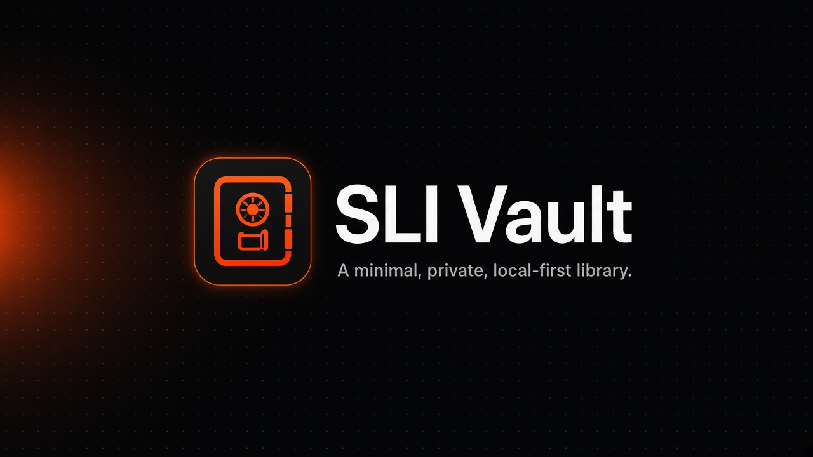

<p align="center">
  
</p>

<p align="center">
  <strong>SLI Vault</strong><br>
  A minimal, private, local-first library for links and images on Android.
</p>

<p align="center">
  
  
  
  
  
</p>

<p align="center">
  <a href="#features">Features</a> ·
  <a href="#screenshots">Screenshots</a> ·
  <a href="#privacy">Privacy</a> ·
  <a href="#setup">Setup</a> ·
  <a href="#build">Build</a> ·
  <a href="#known-limitations">Limitations</a> ·
  <a href="#license">License</a>
</p>

---

## Overview

SLI Vault is a Flutter Android app for saving links and images into **app-private** storage. There is no account, no cloud sync, and no analytics SDK. The production manifest does not request Internet access.

| Platform | Status |
|----------|--------|
| Android | Supported (primary target; device-tested on Android 15) |
| iOS | Scaffold only — not verified as a shipping target |
| Web / Desktop | Flutter platform folders only — not the shipping target |

**Download / release status:** not yet published. There is no GitHub Release, Play Store listing, or signed production APK in this repository. Local debug and release-mode builds are for development only.

A project license has **not** been chosen. Do not treat this repository as MIT, Apache-2.0, or any other open-source license until a `LICENSE` file exists.

---

## Features

- Save **links** and import **images** into durable app-private storage
- Browse, search, filter (All / Links / Images), favorite, tag, and organize into **collections**
- Legacy rows stored as type `screenshot` remain that type and appear under **Images**
- ZIP backup format **v2** (`manifest.json` + `images/<id>`) with SHA-256 and byte length per image; v1 archives still import
- Import of the earlier Kotlin vault JSON shape (including Base64 image bytes)
- Theme: **Dark**, **Light**, or **System**
- Optional lock when backgrounded (device biometric or credential — SQLite is **not** encrypted)
- Onboarding with a short welcome clip and still fallbacks
- Android share-in (`ACTION_SEND` / `ACTION_SEND_MULTIPLE` for text and images)
- Five destinations: Home, Browse, Favorites, Collections, Settings

---

## Screenshots

Device captures of the current UI (empty-state showcase set):

<p align="center">
  
  &nbsp;
  
  &nbsp;
  
</p>

<p align="center">
  
  &nbsp;
  
  &nbsp;
  
</p>

### QA / verification gallery

Selected light/dark and Add-sheet checks (not a full device suite):

| Capture | Path |
|---------|------|
| Home · light · populated | [`21-light-home.png`](docs/screenshots/ui-verification/21-light-home.png) |
| Home · dark · populated | [`31-dark-home.png`](docs/screenshots/ui-verification/31-dark-home.png) |
| Collections · light | [`20-light-coll.png`](docs/screenshots/ui-verification/20-light-coll.png) |
| Add Link · light | [`02-add-sheet-light-link.png`](docs/screenshots/ui-verification/02-add-sheet-light-link.png) |
| Add Image · light | [`03-add-sheet-light-image.png`](docs/screenshots/ui-verification/03-add-sheet-light-image.png) |
| Add Link · dark | [`32-dark-add-link.png`](docs/screenshots/ui-verification/32-dark-add-link.png) |
| Image validation · dark | [`35-image-validation.png`](docs/screenshots/ui-verification/35-image-validation.png) |
| Settings top · light | [`22-light-settings-top.png`](docs/screenshots/ui-verification/22-light-settings-top.png) |
| Settings top · dark | [`30-dark-settings-top.png`](docs/screenshots/ui-verification/30-dark-settings-top.png) |
| Privacy + Danger Zone · light | [`21-light-settings-2.png`](docs/screenshots/ui-verification/21-light-settings-2.png) |

Full QA notes: [docs/TESTING.md](docs/TESTING.md) · [docs/RELEASE_READINESS.md](docs/RELEASE_READINESS.md).

---

## Privacy

> [!IMPORTANT]
> SLI Vault is **local-first**. Records and imported images live in app-private storage on the device. There is no user account, cloud sync, advertising SDK, or telemetry client in the shipping code path. The **production** Android manifest does not declare `INTERNET`. Debug and profile manifests still allow Flutter tooling.

Additional facts from the current tree:

- Optional **lock when backgrounded** uses the system biometric / device credential prompt. It does **not** encrypt the SQLite database.
- Backup ZIPs are **not** encrypted. Treat exported files as private copies.
- Opening a saved URL hands it to another app the user chooses. Copy URL is the only clipboard write from the app.
- **`FLAG_SECURE` is currently OFF** (owner request for local debugging). Screenshot and recent-apps protection is paused until the owner explicitly asks to restore it. See `android/app/src/main/kotlin/com/example/sli_vault/MainActivity.kt`.

---

## Backup and restore

- Export writes a ZIP (format **v2**) with `manifest.json` and image files under `images/`.
- Each image entry carries SHA-256 and byte length. Import validates before writing.
- Existing item IDs are **skipped** (not overwritten). Unsupported schemas are rejected.
- Legacy Kotlin JSON/Base64 backups remain importable where documented.
- Empty custom collection names live in preferences and are not themselves stored in the ZIP; collections that appear on items come back with those items.

Details: [docs/BACKUP_RESTORE.md](docs/BACKUP_RESTORE.md).

---

## Setup

### Requirements

- Flutter **3.47.x** with Dart SDK `^3.13.5` (see `pubspec.yaml`)
- Android SDK + a device or emulator
- JDK suitable for the Android Gradle Plugin (Android Studio’s bundled JBR works). If `JAVA_HOME` points at a missing JDK, set:

```powershell
$env:JAVA_HOME = "C:\Program Files\Android\Android Studio\jbr"
```

### Run

```powershell
git clone <your-fork-or-clone-url>
cd sli-vault
flutter pub get
flutter run
```

---

## Build

Debug APK:

```powershell
$env:JAVA_HOME = "C:\Program Files\Android\Android Studio\jbr"
flutter build apk --debug
```

Release-mode APK and App Bundle (**still debug-signed** until a production keystore exists — do **not** upload these as store artifacts):

```powershell
$env:JAVA_HOME = "C:\Program Files\Android\Android Studio\jbr"
flutter build apk --release
flutter build appbundle --release
```

Outputs stay under `build/` and must not be committed. `publish_to` is `none` in `pubspec.yaml`.

| Artifact | Typical local path | Notes |
|----------|-------------------|--------|
| Debug APK | `build/app/outputs/flutter-apk/app-debug.apk` | Development |
| Release APK | `build/app/outputs/flutter-apk/app-release.apk` | Release mode, debug signing today |
| Release AAB | `build/app/outputs/bundle/release/app-release.aab` | Release mode, debug signing today |

---

## Test and lint

```powershell
$env:JAVA_HOME = "C:\Program Files\Android\Android Studio\jbr"
dart format --output=none --set-exit-if-changed lib test
flutter analyze
flutter test
```

On PowerShell, quote any `--name` filter that contains `|` so the shell does not treat it as a pipe.

There is **no CI workflow** on `HEAD` of this repository. Do not treat badges above as live GitHub Actions status.

---

## Architecture

| Path | Role |
|------|------|
| `lib/domain/` | Item types, validation, search, serialization |
| `lib/data/` | SQLite, image files, `VaultController`, backup |
| `lib/features/` | Screens: onboarding, home, browse, favorites, collections, settings, add sheet, … |
| `lib/core/` | Theme, assets, shared widgets |
| `lib/app/` | Five-tab shell and background lock |
| `android/` | Manifest, share intents, `FLAG_SECURE` hook (currently commented) |
| `docs/` | Architecture, backup, testing, release notes |
| `docs/screenshots/ui-verification/` | Approved showcase + selected QA PNGs |
| `test/` | Host tests with temporary databases |

`VaultController` is a `ChangeNotifier`. The shell uses an `IndexedStack`. See [docs/ARCHITECTURE.md](docs/ARCHITECTURE.md).

---

## Known limitations

These are **release blockers** or open gaps, not marketing copy:

| Item | Current fact |
|------|----------------|
| Application ID | `com.example.sli_vault` (template ID — change before a store listing) |
| Signing | Release APK/AAB use the **debug** signing config; no production keystore in-repo |
| Version display | About UI hard-codes `1.0.0`; `pubspec.yaml` is `1.0.0+1` |
| `FLAG_SECURE` | **Off** until the owner restores the commented `addFlags` call |
| License | **Not chosen** — no `LICENSE` file |
| Fonts | JetBrains Mono is SIL OFL. Anthropic Serif under `assets/fonts/claude/` has **no** license and appears to be a proprietary typeface, so it is **not cleared for redistribution**. Keep this repository private until it is replaced or permission is obtained ([details](assets/fonts/claude/README.md)) |
| Launcher icon | Adaptive foreground fills the canvas; system mask may crop outer glow |
| Device QA gaps | Backup export/import with real files, image handling, biometric lock, restart persistence, and error states are **not tested** on a real device — see [docs/ANDROID_DEVICE_CHECKLIST.md](docs/ANDROID_DEVICE_CHECKLIST.md) |
| Framework assert | `_dependents.isEmpty` reported historically; **not reproduced** in the last QA pass |
| Download | **Not published** — no GitHub Release / store package |

More detail: [docs/RELEASE_READINESS.md](docs/RELEASE_READINESS.md) · [docs/ANDROID_RELEASE.md](docs/ANDROID_RELEASE.md).

---

## Contributing

Bug reports and focused pull requests are welcome after you read [CONTRIBUTING.md](CONTRIBUTING.md) and [SECURITY.md](SECURITY.md). Because no license is chosen yet, ask before sending a large patch.

Do not commit keystores, `key.properties`, `.env` files, vault databases, backup ZIPs, or anything under `build/`, `.dart_tool/`, or `artifacts/`.

---

## License

**Not chosen.** There is no `LICENSE` file. All rights remain with the copyright holder until one is added.

Third-party notices that do exist:

- **JetBrains Mono** — SIL Open Font License 1.1 (`assets/fonts/jetbrains_mono/OFL.txt`)
- Dart / Flutter package licenses — available in-app via the open-source licenses screen

---

## Download

**Not yet published.**

When a signed release exists, it will be announced with a GitHub Release or store listing. Until then, clone the repo and build locally with the commands above. Do not treat debug-signed release APKs as distributable store packages.
