<div align="center">
  
</div>

<p align="center">
  <strong>SLI Vault</strong><br>
  A minimal, private, local-first library for links and images on Android.
</p>

<p align="center">
  
  
  
  
  
</p>

<p align="center">
  <a href="#features">Features</a> ·
  <a href="#screenshots">Screenshots</a> ·
  <a href="#privacy">Privacy</a> ·
  <a href="#setup">Setup</a> ·
  <a href="#build">Build</a> ·
  <a href="#known-limitations">Limitations</a> ·
  <a href="#license">License</a>
</p>

---

## Overview

SLI Vault is a Flutter Android app for saving links and images into **app-private** storage. There is no account, no cloud sync, and no analytics SDK. The production manifest does not request Internet access.

| Platform | Status |
|----------|--------|
| Android | Primary target; development builds compile successfully |
| iOS | Phase 2 - scaffold only, not verified as a shipping target |
| Web / Desktop | Flutter platform folders only - not the shipping target |

**Download / release status:** a **signed GitHub Release APK** is available under [Releases](https://github.com/sahaya-savari/sli-vault/releases). Application ID `com.sahayasavari.slivault`. There is **no Play Store listing** - sideload / open-source distribution only.

The project-owned code and documentation are licensed under [MIT](LICENSE). Third-party assets are separate: in particular, Anthropic Serif remains **not cleared for redistribution**. See [the font notice](assets/fonts/claude/README.md).

---

## Features

- Save **links** and import **images** into durable app-private storage
- Browse, search, filter (All / Links / Images), favorite, tag, and organize into **collections**
- Legacy rows stored as type `screenshot` remain that type and appear under **Images**
- ZIP backup format **v2** (`manifest.json` + `images/<id>`) with SHA-256 and byte length per image; v1 archives still import
- Import of the earlier Kotlin vault JSON shape (including Base64 image bytes)
- Theme: **Dark**, **Light**, or **System**
- Optional lock when backgrounded (device biometric or credential - SQLite is **not** encrypted)
- Onboarding with a short welcome clip and still fallbacks
- Android share-in (`ACTION_SEND` / `ACTION_SEND_MULTIPLE` for text and images)
- Five destinations: Home, Browse, Favorites, Collections, Settings

---

## Screenshots

The current Android UI, captured from the six primary destinations and onboarding:

<div align="center">

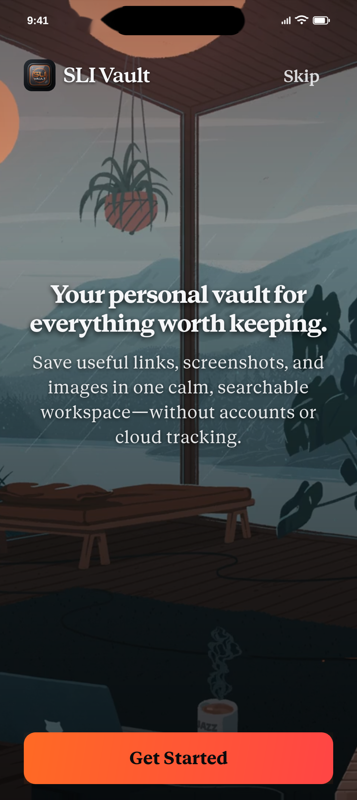
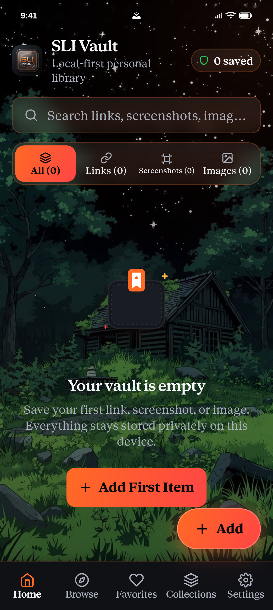
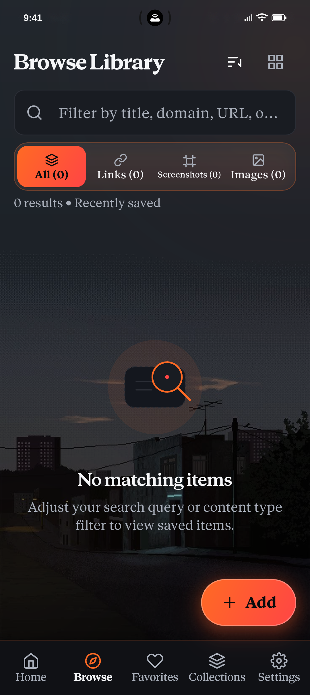
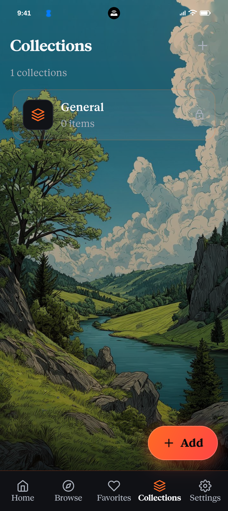

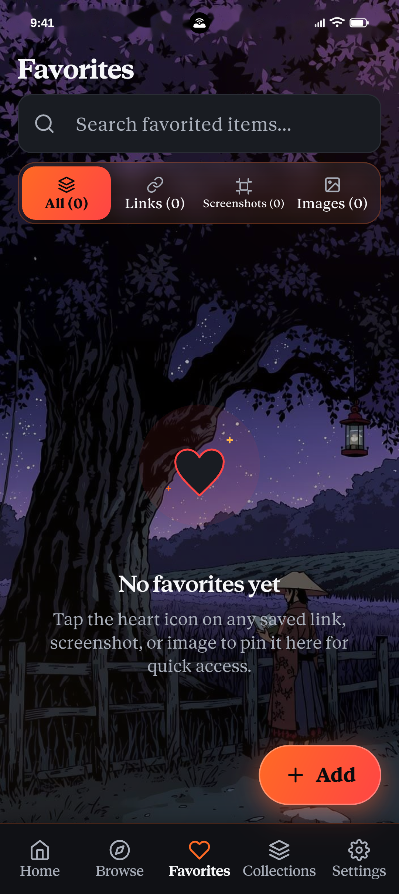
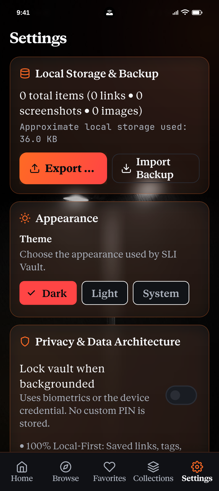

<sub><b>Welcome</b> · <b>Home</b> · <b>Browse</b> · <b>Collections</b> · <b>Favorites</b> · <b>Settings</b></sub>

</div>

### QA / verification gallery

Selected light/dark and Add-sheet checks (not a full device suite):

<p align="center"><b>Home</b></p>
<p align="center">
  <a href="docs/screenshots/ui-verification/21-light-home.png">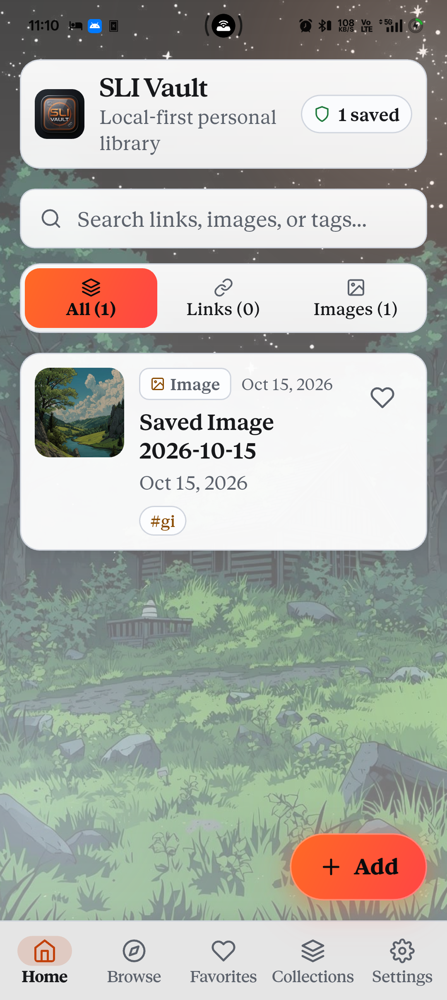</a>
  <a href="docs/screenshots/ui-verification/31-dark-home.png">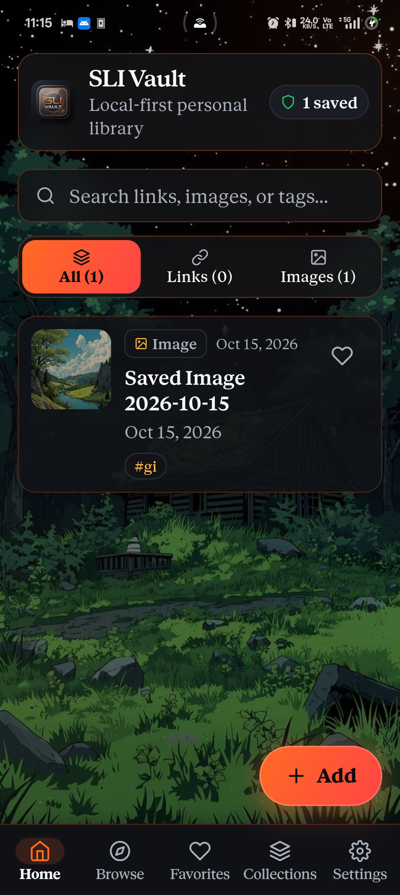</a>
</p>
<p align="center"><b>Collections</b></p>
<p align="center"><a href="docs/screenshots/ui-verification/20-light-coll.png">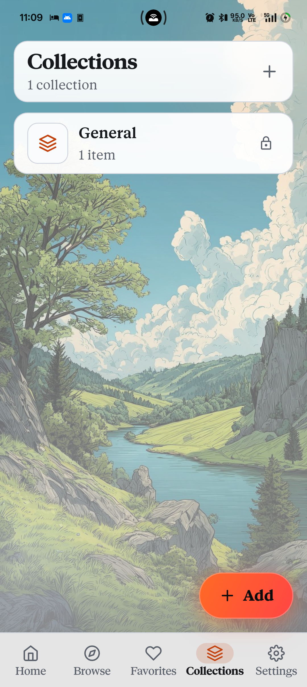</a></p>
<p align="center"><b>Add Link / Image</b></p>
<p align="center">
  <a href="docs/screenshots/ui-verification/02-add-sheet-light-link.png">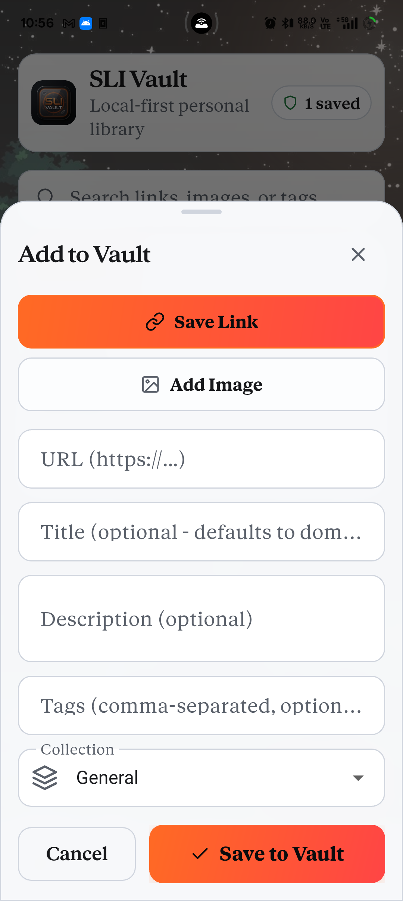</a>
  <a href="docs/screenshots/ui-verification/03-add-sheet-light-image.png">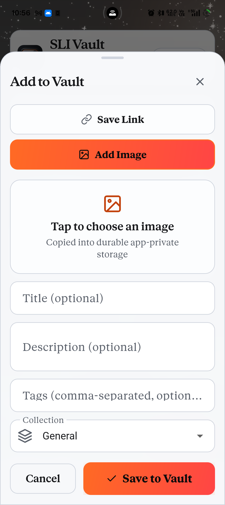</a>
  <a href="docs/screenshots/ui-verification/32-dark-add-link.png">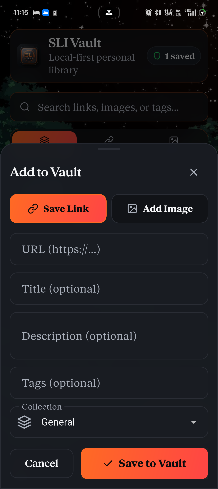</a>
</p>
<p align="center"><b>Image Validation</b></p>
<p align="center"><a href="docs/screenshots/ui-verification/35-image-validation.png">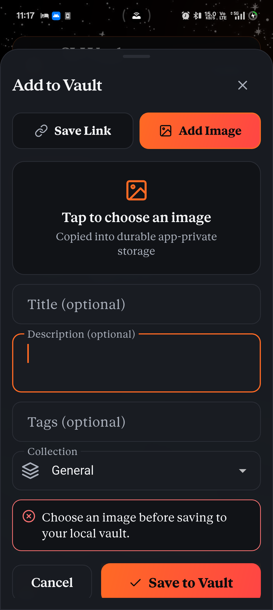</a></p>
<p align="center"><b>Settings</b></p>
<p align="center">
  <a href="docs/screenshots/ui-verification/22-light-settings-top.png">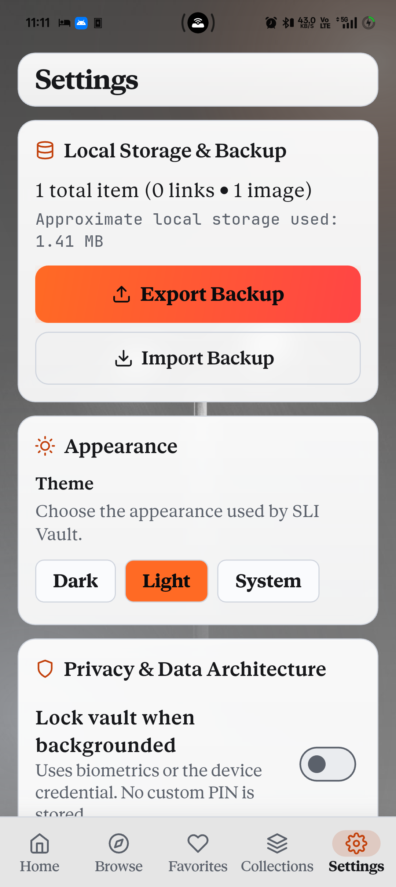</a>
  <a href="docs/screenshots/ui-verification/30-dark-settings-top.png">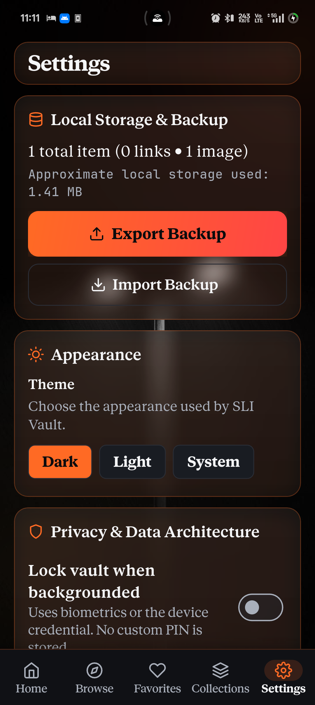</a>
</p>
<p align="center"><b>Privacy / Danger Zone</b></p>
<p align="center"><a href="docs/screenshots/ui-verification/21-light-settings-2.png">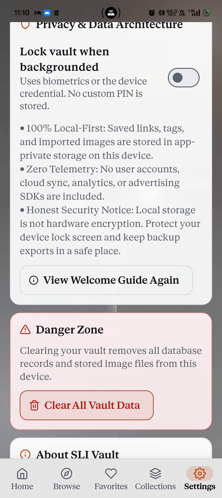</a></p>

Full QA notes: [docs/TESTING.md](docs/TESTING.md) · [docs/RELEASE_READINESS.md](docs/RELEASE_READINESS.md).

---

## Release documentation

- [Android release guide](docs/ANDROID_RELEASE.md) — build, signing, and artifact verification
- [Android device checklist](docs/ANDROID_DEVICE_CHECKLIST.md) — all physical-device checks remain **NOT TESTED**
- [Release readiness gate](docs/RELEASE_READINESS.md) — blockers and evidence
- [Testing notes](docs/TESTING.md) — automated coverage and validation classification

---

## Privacy

> [!IMPORTANT]
> SLI Vault is **local-first**. Records and imported images live in app-private storage on the device. There is no user account, cloud sync, advertising SDK, or telemetry client in the shipping code path. The **production** Android manifest does not declare `INTERNET`. Debug and profile manifests still allow Flutter tooling.

Additional facts from the current tree:

- Optional **lock when backgrounded** uses the system biometric / device credential prompt. It does **not** encrypt the SQLite database.
- Backup ZIPs are **not** encrypted. Treat exported files as private copies.
- Opening a saved URL hands it to another app the user chooses. Copy URL is the only clipboard write from the app.
- **`FLAG_SECURE` is ON** in `MainActivity` (`onCreate` / `onResume`). On supporting devices this blocks screenshots, screen recording of the app window, and recent-apps content previews. Physical-device confirmation of those limitations remains **NOT TESTED**.

---

## Backup and restore

- Export writes a ZIP (format **v2**) with `manifest.json` and image files under `images/`.
- Each image entry carries SHA-256 and byte length. Import validates before writing.
- Existing item IDs are **skipped** (not overwritten). Unsupported schemas are rejected.
- Legacy Kotlin JSON/Base64 backups remain importable where documented.
- Empty custom collection names live in preferences and are not themselves stored in the ZIP; collections that appear on items come back with those items.

Details: [docs/BACKUP_RESTORE.md](docs/BACKUP_RESTORE.md).

---

## Setup

### Requirements

- Flutter **3.47.x** with Dart SDK `^3.13.5` (see `pubspec.yaml`)
- Android SDK + a device or emulator
- JDK suitable for the Android Gradle Plugin (Android Studio’s bundled JBR works). If `JAVA_HOME` points at a missing JDK, set:

```powershell
$env:JAVA_HOME = "C:\Program Files\Android\Android Studio\jbr"
```

### Run

```powershell
git clone <your-fork-or-clone-url>
cd sli-vault
flutter pub get
flutter run
```

---

## Build

Debug APK:

```powershell
$env:JAVA_HOME = "C:\Program Files\Android\Android Studio\jbr"
flutter build apk --debug
```

Release-mode APK and App Bundle (**still debug-signed** until a production keystore exists — do **not** upload these as store artifacts):

```powershell
$env:JAVA_HOME = "C:\Program Files\Android\Android Studio\jbr"
flutter build apk --release
flutter build appbundle --release
```

Outputs stay under `build/` and must not be committed. `publish_to` is `none` in `pubspec.yaml`.

| Artifact | Typical local path | Notes |
|----------|-------------------|--------|
| Debug APK | `build/app/outputs/flutter-apk/app-debug.apk` | Development |
| Release APK | `build/app/outputs/flutter-apk/app-release.apk` | 63,521,428 bytes (60.58 MiB), debug-signed |
| Release AAB | `build/app/outputs/bundle/release/app-release.aab` | 63,540,169 bytes (60.60 MiB), debug-signed |

---

## Test and lint

```powershell
$env:JAVA_HOME = "C:\Program Files\Android\Android Studio\jbr"
dart format --output=none --set-exit-if-changed lib test
flutter analyze
flutter test
```

On PowerShell, quote any `--name` filter that contains `|` so the shell does not treat it as a pipe.

There is **no CI workflow** on `HEAD` of this repository. Do not treat badges above as live GitHub Actions status.

---

## Architecture

| Path | Role |
|------|------|
| `lib/domain/` | Item types, validation, search, serialization |
| `lib/data/` | SQLite, image files, `VaultController`, backup |
| `lib/features/` | Screens: onboarding, home, browse, favorites, collections, settings, add sheet, … |
| `lib/core/` | Theme, assets, shared widgets |
| `lib/app/` | Five-tab shell and background lock |
| `android/` | Manifest, share intents, `FLAG_SECURE` enabled on the main activity |
| `docs/` | Architecture, backup, testing, release notes |
| `docs/screenshots/ui-verification/` | Approved showcase + selected QA PNGs |
| `test/` | Host tests with temporary databases |

`VaultController` is a `ChangeNotifier`. The shell uses an `IndexedStack`. See [docs/ARCHITECTURE.md](docs/ARCHITECTURE.md).

---

## Known limitations

These are **release blockers** or open gaps, not marketing copy:

| Item | Current fact |
|------|----------------|
| Application ID | `com.sahayasavari.slivault` |
| Signing | Release builds use a **local** owner keystore via `android/key.properties` (never committed). Not enrolled in Play App Signing |
| Version display | About UI and `pubspec.yaml` are `1.0.1` / versionCode `2` (still hard-coded strings, not `package_info_plus`) |
| `FLAG_SECURE` | **On** in `MainActivity` (source + contract test); physical-device capture checks remain **NOT TESTED** |
| License | MIT for project-owned code and documentation; third-party assets remain separately licensed |
| Fonts | JetBrains Mono is SIL OFL. Anthropic Serif under `assets/fonts/claude/` is **not cleared for redistribution**; keep this repository private until permission or replacement |
| Launcher icon | Adaptive foreground fills the canvas; system mask may crop outer glow |
| Device QA gaps | Backup export/import with real files, image handling, biometric lock, restart persistence, and error states are **not tested** on a real device — see [docs/ANDROID_DEVICE_CHECKLIST.md](docs/ANDROID_DEVICE_CHECKLIST.md) |
| Framework assert | `_dependents.isEmpty` reported historically; **not reproduced** in the last QA pass |
| Download | GitHub **signed** APK (owner keystore); not on Play Store |

More detail: [docs/RELEASE_READINESS.md](docs/RELEASE_READINESS.md) · [docs/ANDROID_RELEASE.md](docs/ANDROID_RELEASE.md).

---

## Contributing

Bug reports and focused pull requests are welcome after you read [CONTRIBUTING.md](CONTRIBUTING.md) and [SECURITY.md](SECURITY.md).

Do not commit keystores, `key.properties`, `.env` files, vault databases, backup ZIPs, or anything under `build/`, `.dart_tool/`, or `artifacts/`.

---

## License

Project-owned code and documentation are licensed under the [MIT License](LICENSE). MIT does **not** cover Anthropic Serif or other third-party assets; see [assets/fonts/claude/README.md](assets/fonts/claude/README.md).

Third-party notices that do exist:

- **JetBrains Mono** — SIL Open Font License 1.1 (`assets/fonts/jetbrains_mono/OFL.txt`)
- Dart / Flutter package licenses — available in-app via the open-source licenses screen

---

## Download

**GitHub Release (signed APK, no Play Store):**

- [Latest Releases](https://github.com/sahaya-savari/sli-vault/releases) — install the attached `sli-vault-*-release.apk`
- Application ID: `com.sahayasavari.slivault`
- Current tree version: `1.0.1` (`versionCode` `2`)
- Signing: owner release keystore (local `android/key.properties` or GitHub Actions secrets; never in Git)
- Production CI: [Android production release](.github/workflows/android-release.yml) (`workflow_dispatch` only)
- Platforms: Android only for this package; iOS remains Phase 2 — see [docs/IOS_RELEASE.md](docs/IOS_RELEASE.md)
- Play Store: **not listed** — this is a GitHub sideload package, not a Play upload

To reproduce a signed build locally you need `android/key.properties` and the keystore outside the repo (see [docs/ANDROID_RELEASE.md](docs/ANDROID_RELEASE.md)).
