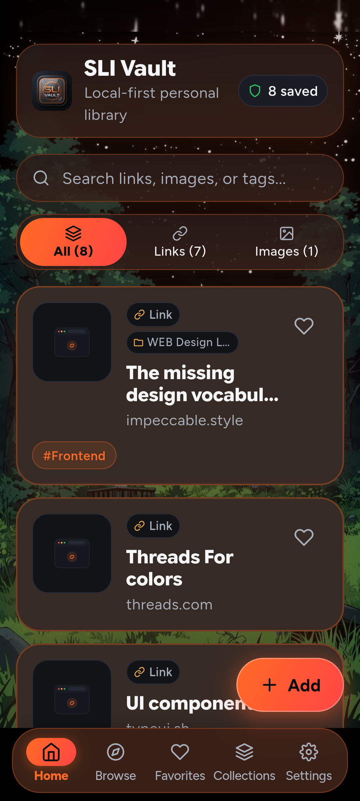
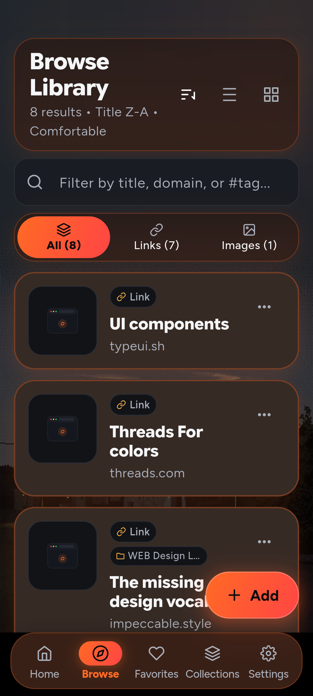
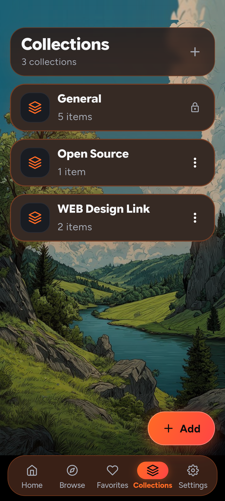
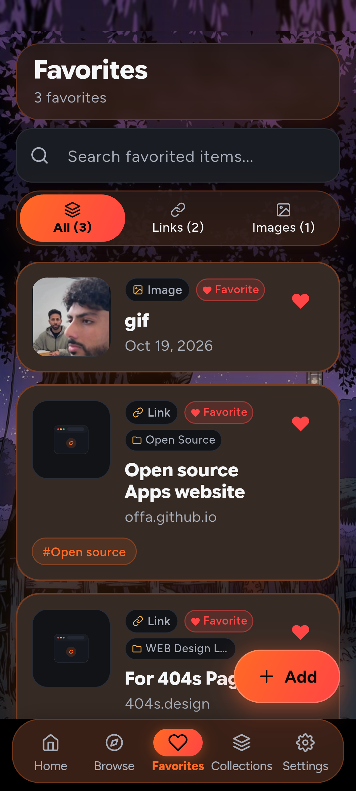
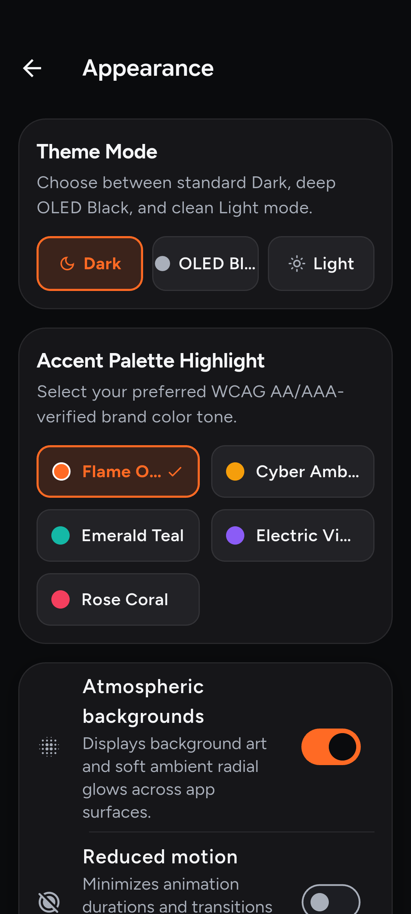
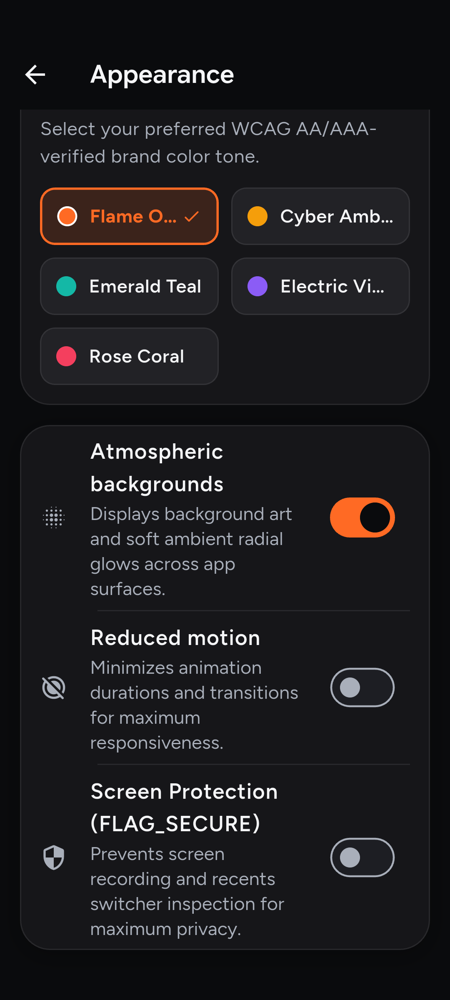
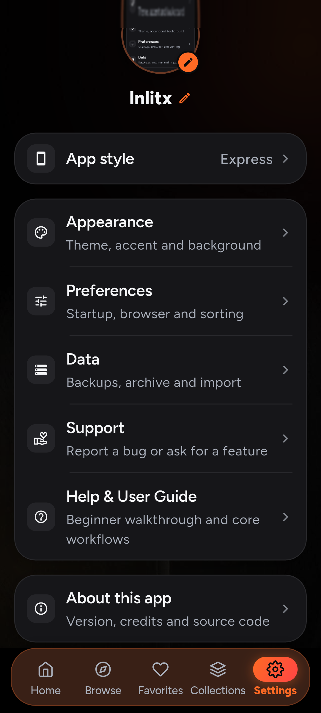

<div align="center">
  
</div>

<p align="center">
  <strong>SLI Vault</strong><br>
  A minimal, private, local-first library for links and images on Android.
</p>

<p align="center">
  
  
  
  
  
</p>

<p align="center">
  <a href="#overview">Overview</a> ·
  <a href="#features">Features</a> ·
  <a href="#translating-sli-vault">Translations</a> ·
  <a href="#visual-tour--features">Tour</a> ·
  <a href="#privacy">Privacy</a> ·
  <a href="#download">Download</a> ·
  <a href="#setup">Setup</a> ·
  <a href="#build">Build</a> ·
  <a href="#known-limitations">Limitations</a> ·
  <a href="#license">License</a>
</p>

---

## Overview

SLI Vault is a Flutter Android app for saving links and images into **app-private** storage. There is no account, no cloud sync, and no analytics SDK. The production manifest does not request Internet access.

| Property | Current Detail |
|---|---|
| **Application ID** | `com.sahayasavari.slivault` |
| **Current Version** | `1.0.1` (`versionCode` `2010`, arm64 `4010`) |
| **Distribution** | Signed APK and AAB on [GitHub Releases](https://github.com/sahaya-savari/sli-vault/releases) - sideload only, no Play Store listing |
| **Data Model** | 100% local-first: SQLite + app-private image files |
| **License** | [MIT](LICENSE) for project-owned code and docs (fonts under SIL OFL 1.1) |

The Flutter mobile application resides directly at the **repository root**. The repository is architected as a lightweight monorepo accommodating:
1. The **Flutter/Dart Android mobile app** at the repository root.
2. The **companion website** (Vite + Nitro + TanStack Start) under `website/`.

| Component / Platform | Status |
|----------------------|--------|
| Android (Root) | Primary target; signed GitHub Release available (`v1.0.1`) |
| iOS | Phase 2 - scaffold only, not verified as a shipping target |
| Web / Desktop | Flutter platform folders only - not the shipping target |
| Website (`website/`) | Companion website (Vite/Nitro); see [docs/WEBSITE_SETUP.md](docs/WEBSITE_SETUP.md) |

**Download / release status:** a **signed GitHub Release APK** is available under [Releases](https://github.com/sahaya-savari/sli-vault/releases). Application ID `com.sahayasavari.slivault`. There is **no Play Store listing** - sideload / open-source distribution only.

The project-owned code and documentation are licensed under [MIT](LICENSE). Bundled fonts (Figtree, Google Sans Flex, JetBrains Mono) are licensed under the SIL Open Font License 1.1 (see `assets/fonts/figtree/OFL.txt`, `assets/fonts/google_sans_flex/OFL.txt`, and `assets/fonts/jetbrains_mono/OFL.txt`).

---

## Features

### Save and organize
- Save links, import images, and capture **offline Markdown notes & code snippets** into durable app-private storage
- Markdown notes feature syntax highlighting using the bundled JetBrains Mono font and interactive checklists (`- [ ]` / `- [x]`)
- Organize into collections on save with inline collection creation in the Add flow
- Interactive **Tag Ribbon & Tag Cloud** with frequency counts (`#design (12)`) and 1-tap filtering
- **Domain / Website filters** (`github.com (15)`) to browse bookmarks grouped by source site
- OpenGraph rich metadata and preview thumbnails for saved links
- Estimated **reading time badges** (`~3 min read`) and offline reader mode with adjustable font sizes
- Native **dominant color palette extractor** for saved images (extracts top 5 hex colors with 1-tap clipboard copy)
- Android **dynamic app shortcuts** on home screen long-press (Quick Add Link, Save Image, New Note, Search Vault)
- Android share-in (`ACTION_SEND` / `ACTION_SEND_MULTIPLE` for text, links, and images)

### Backup and safety
- **Scheduled local backup reminders** (in-app indicator when 14+ days have passed since last safety export)
- Complete portable ZIP backup format v3 (`manifest.json` + `images/<id>` + `links.csv` + `README.txt`) with SHA-256 and byte length per image
- Standalone CSV export with spreadsheet formula injection protection
- Empty custom collection retention and restoration
- Backward compatible: imports legacy v1 and v2 archives safely
- 100% offline with zero cloud sync, zero telemetry, and zero tracking

### Look and feel
- Three distinct visual styles:
  - **Classic:** Timeless library experience with balanced 16dp radii, rich dark contrast, and Anthropic Serif typography.
  - **Minimal:** Crisp 8dp lines, tight padding, and Figtree content-first typography.
  - **Express:** Sculpted 24dp squircle curves, Google Sans Flex, pill badges, and refined micro-motion.
- Theme: OLED Black (obsidian pure black with defined borders for AMOLED displays), Dark, Light, or System
- Rotating authentic WebP artworks across loading and plates
- Modernized creator showcase featuring Sahaya Savari F (MSc AI Student, Madurai, Tamil Nadu) in About section
- Built-in **Help & User Guide** in Settings for offline tips and gesture walkthroughs

### Privacy controls
- Optional lock when backgrounded (device biometric or credential with selectable timeout options: Immediately, 5s, 10s, 30s, 1 minute, 5 minutes; persisted securely)
- Zero telemetry, zero analytics SDKs, and no tracking of any kind.

---

## Translating SLI Vault

Translations can be contributed by the community as the project expands its language support.

If community translation support is not yet configured, contributors can open a [GitHub issue](https://github.com/sahaya-savari/sli-vault/issues) to discuss adding or improving a translation. Automated translation pipelines or platforms (such as Weblate) are not currently configured for this repository.

### Translation guidelines

- **Propose a translation or new language:** Open an issue titled `[i18n] Add <Language> translation` to coordinate before beginning work on string extraction or file formats.
- **Tone & style:** Keep translations concise, natural, and consistent with SLI Vault's calm, privacy-focused tone. Avoid marketing buzzwords or unnecessary embellishments.
- **Placeholders & technical terms:** Preserve all code placeholders (e.g. `%s`, `{count}`) and formatting markers exactly. Do not translate the product name (`SLI Vault`), local storage format identifiers (`SQLite`, `ZIP v2`), or system properties (`FLAG_SECURE`).
- **Reporting translation issues:** Report typos, wording suggestions, or UI truncation bugs directly on the [GitHub Issues](https://github.com/sahaya-savari/sli-vault/issues) tracker.

---

## Visual tour & features

The key capabilities of SLI Vault across daily capture, organization, and backup:

<table align="center" width="100%">
  <tr>
    <td align="center" valign="top" width="33%">
      
      <br>
      <b>01 · Keep Everything</b><br>
      <sub>Save links, captures, and images with 100% on-device SQLite storage.</sub>
    </td>
    <td align="center" valign="top" width="33%">
      
      <br>
      <b>02 · Instant Search</b><br>
      <sub>Search across titles, URLs, notes, and filter by type in milliseconds.</sub>
    </td>
    <td align="center" valign="top" width="33%">
      
      <br>
      <b>03 · Favourites Shortlist</b><br>
      <sub>Quickly access your most valued bookmarks and reference material.</sub>
    </td>
  </tr>
  <tr>
    <td align="center" valign="top" width="33%">
      
      <br>
      <b>04 · Custom Collections</b><br>
      <sub>Group items into dedicated workspaces like Design Systems and Inspiration.</sub>
    </td>
    <td align="center" valign="top" width="33%">
      
      <br>
      <b>05 · Backup & Export</b><br>
      <sub>Portable ZIP v3 archives with SHA-256 verification and zero lock-in.</sub>
    </td>
    <td align="center" valign="top" width="33%">
      
      <br>
      <b>06 · Private by Design</b><br>
      <sub>Zero analytics, no accounts, and optional biometric authentication.</sub>
    </td>
  </tr>
</table>

---

## App Screenshots & Visual Gallery

All screenshots are authentic captures from the running Android app, sanitized with zero status bar clutter (no notifications, network indicators, or hotspot capsules) and formatted to standard 1080×2400 (20:9) resolution.

<table align="center" width="100%">
  <tr>
    <td align="center" valign="top" width="25%">
      
      <br>
      <b>Vault Home</b><br>
      <sub>Library overview, tag ribbon & dynamic shortcuts.</sub>
    </td>
    <td align="center" valign="top" width="25%">
      
      <br>
      <b>Browse & Filter</b><br>
      <sub>Multi-type filters, search, and sorting.</sub>
    </td>
    <td align="center" valign="top" width="25%">
      
      <br>
      <b>Curated Collections</b><br>
      <sub>Color-accented collections with nature backdrops.</sub>
    </td>
    <td align="center" valign="top" width="25%">
      
      <br>
      <b>Favorites Shortlist</b><br>
      <sub>Quick access to pinned links & visual inspirations.</sub>
    </td>
  </tr>
  <tr>
    <td align="center" valign="top" width="25%">
      
      <br>
      <b>Theme Modes</b><br>
      <sub>OLED Black, Dark, Light & 5 WCAG verified accents.</sub>
    </td>
    <td align="center" valign="top" width="25%">
      
      <br>
      <b>Visual Controls</b><br>
      <sub>Atmospheric art, motion toggles & FLAG_SECURE.</sub>
    </td>
    <td align="center" valign="top" width="25%">
      
      <br>
      <b>Settings & Security</b><br>
      <sub>Biometric lock, portable ZIP backup, and cleanup.</sub>
    </td>
    <td align="center" valign="top" width="25%">
      <br><br><br>
      <b>Open Source &amp; Free</b><br>
      <sub>100% private, zero telemetry. Download APKs directly from <a href="https://github.com/sahaya-savari/sli-vault/releases/latest">GitHub Releases</a>.</sub>
    </td>
  </tr>
</table>

### Screenshot Inventory & Locations

- **High-Resolution Screenshots:** [`docs/screenshots/readme/`](docs/screenshots/readme/) — Clean, full-bleed 1080×2400 mobile interface captures.
- **Store Graphics & Package Assets:** [`docs/screenshots/play_store/`](docs/screenshots/play_store/) — 512×512 app icon, 1024×500 feature graphic, and clean store screenshots.
- Detailed specifications: [`docs/screenshots/manifest.md`](docs/screenshots/manifest.md).

---

## Download

SLI Vault is **100% Free and Open-Source Software (FOSS)** distributed directly via GitHub Releases and the official companion website. There are no ads, no trackers, and no Google Play account required to install and use the app.

### Official Releases

Latest Stable: **[v1.0.1](https://github.com/sahaya-savari/sli-vault/releases/tag/v1.0.1)** (`versionCode 2008`)

| Package | Target Architecture | Direct Download | SHA-256 Checksum |
| :--- | :--- | :---: | :---: |
| **`arm64-v8a` (Recommended)** | Most modern Android phones (Android 8.0+) | [Download APK (27.9 MB)](https://github.com/sahaya-savari/sli-vault/releases/download/v1.0.1/sli-vault-v1.0.1-arm64-v8a.apk) | `5F248A1B94C65B7BE55ACEEA02A902EB56BEDD29487DCF20522DAA6324517489` |
| **Universal** | All Android devices (arm64, arm32, x86) | [Download APK (67.9 MB)](https://github.com/sahaya-savari/sli-vault/releases/download/v1.0.1/sli-vault-v1.0.1-universal.apk) | `579F7E9FFC39E7F21116A88FE2FC13F908F0B0861034F9493086685CAD2A96DE` |
| **`armeabi-v7a`** | Older 32-bit Android phones | [Download APK (25.8 MB)](https://github.com/sahaya-savari/sli-vault/releases/download/v1.0.1/sli-vault-v1.0.1-armeabi-v7a.apk) | `FB3F870BA957577C359F97443E296BF67ABDF092CCDB112651ECBC565B356369` |
| **`x86_64`** | Emulators and ChromeOS tablets | [Download APK (29.4 MB)](https://github.com/sahaya-savari/sli-vault/releases/download/v1.0.1/sli-vault-v1.0.1-x86_64.apk) | `78BB4EB2A0AE0F8CC894D1934151527F7BF72211C4E8C452D4DCF68A342440F4` |

🌐 **Official Companion Website & Web Viewer:** [https://sahaya-savari.github.io/sli-vault/](https://sahaya-savari.github.io/sli-vault/)

### How to Install (Sideloading)
1. Download the **`arm64-v8a` APK** directly on your Android phone (or Universal if unsure).
2. When prompted by your browser or file manager, tap **Settings** and enable **Allow from this source** ("Install unknown apps").
3. Tap **Install**.
4. All future updates can be installed directly over existing versions without losing your saved links, notes, or images.

---

## Release documentation

- [Android release guide](docs/ANDROID_RELEASE.md) - build, signing, and artifact verification
- [Android device checklist](docs/ANDROID_DEVICE_CHECKLIST.md) - physical-device checks verified on OPPO CPH2569 (Android 15)
- [Release readiness gate](docs/RELEASE_READINESS.md) - blockers and evidence
- [Testing notes](docs/TESTING.md) - automated coverage and validation classification

---

## Privacy

> [!IMPORTANT]
> SLI Vault is **local-first**. Records and imported images live in app-private storage on the device. There is no user account, cloud sync, advertising SDK, or telemetry client in the shipping code path. The **production** Android manifest does not declare `INTERNET`. Debug and profile manifests still allow Flutter tooling.

Additional facts from the current tree:

- Optional **lock when backgrounded** uses the system biometric / device credential prompt. It does **not** encrypt the SQLite database.
- Backup ZIPs are **not** encrypted. Treat exported files as private copies.
- Opening a saved URL hands it to another app the user chooses. Copy URL is the only clipboard write from the app.
- **`FLAG_SECURE` is removed** in `MainActivity` (`onCreate` / `onResume`), allowing users to take screenshots and record screens normally. Privacy is maintained via app lock and biometric authentication.

---

## Backup and restore

- Export writes a ZIP (format **v2**) with `manifest.json` and image files under `images/`.
- Each image entry carries SHA-256 and byte length. Import validates before writing.
- Existing item IDs are **skipped** (not overwritten). Unsupported schemas are rejected.
- Legacy Kotlin JSON/Base64 backups remain importable where documented.
- Empty custom collection names live in preferences and are not themselves stored in the ZIP; collections that appear on items come back with those items.

Details: [docs/BACKUP_RESTORE.md](docs/BACKUP_RESTORE.md).

---

## Setup

### Requirements

- Flutter **3.47.x** with Dart SDK `^3.13.5` (see `pubspec.yaml`)
- Android SDK + a device or emulator
- JDK suitable for the Android Gradle Plugin (Android Studio’s bundled JBR works). If `JAVA_HOME` points at a missing JDK, set:

```powershell
$env:JAVA_HOME = "C:\Program Files\Android\Android Studio\jbr"
```

### Run

```powershell
git clone <your-fork-or-clone-url>
cd sli-vault
flutter pub get
flutter run
```

---

## Build

Debug APK:

```powershell
$env:JAVA_HOME = "C:\Program Files\Android\Android Studio\jbr"
flutter build apk --debug
```

Release-mode APK and App Bundle (**signed** with the owner release keystore):

```powershell
$env:JAVA_HOME = "C:\Program Files\Android\Android Studio\jbr"
flutter build apk --release
flutter build appbundle --release
```

Outputs stay under `build/` and must not be committed. `publish_to` is `none` in `pubspec.yaml`.

| Artifact | Typical local path | Notes |
|----------|-------------------|--------|
| Debug APK | `build/app/outputs/flutter-apk/app-debug.apk` | Development |
| Release APK | `build/app/outputs/flutter-apk/app-release.apk` | 63,521,428 bytes (60.58 MiB), debug-signed |
| Release AAB | `build/app/outputs/bundle/release/app-release.aab` | 63,540,169 bytes (60.60 MiB), debug-signed |

---

## Test and lint

```powershell
$env:JAVA_HOME = "C:\Program Files\Android\Android Studio\jbr"
dart format --output=none --set-exit-if-changed lib test
flutter analyze
flutter test
```

On PowerShell, quote any `--name` filter that contains `|` so the shell does not treat it as a pipe.

Automated pull_request / push CI is not enabled on `HEAD` for Flutter; `.github/workflows/android-release.yml` provides manual production release builds (`workflow_dispatch` only). Website changes under `website/` are validated by `.github/workflows/website-ci.yml` (lint, test, build - no deploy).

---

## Architecture

The Flutter mobile application resides directly at the **repository root**. The companion website under `website/` has an independent Bun/npm dependency lifecycle - see [docs/WEBSITE_SETUP.md](docs/WEBSITE_SETUP.md).

| Path | Role |
|------|------|
| `lib/domain/` | Item types, validation, search, serialization |
| `lib/data/` | SQLite, image files, `VaultController`, backup |
| `lib/features/` | Screens: onboarding, home, browse, favorites, collections, settings, add sheet, … |
| `lib/core/` | Theme, assets, shared widgets |
| `lib/app/` | Five-tab shell and background lock |
| `android/` | Manifest, share intents, biometrics, screenshot capture enabled |
| `docs/` | Architecture, backup, testing, release notes |
| `test/` | Host tests with temporary databases |
| `website/` | Companion React + TypeScript + Vite showcase (isolated workspace; Bun lockfile) |

`VaultController` is a `ChangeNotifier`. The shell uses an `IndexedStack`. See [docs/ARCHITECTURE.md](docs/ARCHITECTURE.md).

---

## Known limitations

These are **release blockers** or open gaps, not marketing copy:

| Item | Current fact |
|------|----------------|
| Application ID | `com.sahayasavari.slivault` |
| Signing | Release builds use a **local** owner keystore via `android/key.properties` (never committed). Not enrolled in Play App Signing |
| Version display | Harmonized via `SliVersion`: `1.0.1` / versionCode `2008` (centralized in `lib/core/constants/sli_version.dart`) |
| `FLAG_SECURE` | **Removed** from `MainActivity` so users can take screenshots normally; verified via contract test |
| License | MIT for project-owned code and documentation; third-party assets remain separately licensed |
| Fonts | All fonts licensed under SIL Open Font License 1.1 (**Figtree**, **Google Sans Flex**, and **JetBrains Mono**). Unverified Claude fonts removed from app bundle |
| Launcher icon | Adaptive foreground fills the canvas; system mask may crop outer glow |
| Device QA gaps | Backup export/import with real files, image handling, biometric lock, restart persistence, and error states are **not tested** on a real device - see [docs/ANDROID_DEVICE_CHECKLIST.md](docs/ANDROID_DEVICE_CHECKLIST.md) |
| Framework assert | `_dependents.isEmpty` reported historically; **not reproduced** in the last QA pass |
| Download | GitHub **signed** APK (owner keystore); not on Play Store |

More detail: [docs/RELEASE_READINESS.md](docs/RELEASE_READINESS.md) · [docs/ANDROID_RELEASE.md](docs/ANDROID_RELEASE.md).

---

## Contributing

Bug reports and focused pull requests are welcome after you read [CONTRIBUTING.md](CONTRIBUTING.md) and [SECURITY.md](SECURITY.md).

Do not commit keystores, `key.properties`, `.env` files, vault databases, backup ZIPs, or anything under `build/`, `.dart_tool/`, or `artifacts/`.

---

## License

Project-owned code and documentation are licensed under the [MIT License](LICENSE). MIT does **not** cover Anthropic Serif or other third-party assets; see [assets/fonts/claude/README.md](assets/fonts/claude/README.md).

Third-party notices that do exist:

- **Figtree** - SIL Open Font License 1.1 (`assets/fonts/figtree/OFL.txt`)
- **Google Sans Flex** - SIL Open Font License 1.1 (`assets/fonts/google_sans_flex/OFL.txt`)
- **JetBrains Mono** - SIL Open Font License 1.1 (`assets/fonts/jetbrains_mono/OFL.txt`)
- Dart / Flutter package licenses - available in-app via the open-source licenses screen

---

## Download

**GitHub Release (signed APK, no Play Store):**

- [Latest Releases](https://github.com/sahaya-savari/sli-vault/releases) - install the attached `sli-vault-v1.0.1-*.apk`
- Application ID: `com.sahayasavari.slivault`
- Current tree version: `1.0.1` (`versionCode` `2008`)
- Signing: owner release keystore (local `android/key.properties` or GitHub Actions secrets; never in Git)
- Production CI: [Android production release](.github/workflows/android-release.yml) (`workflow_dispatch` only)
- Platforms: Android only for this package; iOS remains Phase 2 - see [docs/IOS_RELEASE.md](docs/IOS_RELEASE.md)
- Play Store: **not listed** - this is a GitHub sideload package, not a Play upload

To reproduce a signed build locally you need `android/key.properties` and the keystore outside the repo (see [docs/ANDROID_RELEASE.md](docs/ANDROID_RELEASE.md)).

---

### Author & Craftsmanship

**Sahaya Savari F**
- **Role:** MSc AI Student • Madurai, Tamil Nadu
- **Portfolio:** [sahayasavari.dev](https://sahayasavari.dev)
- **Email:** [sahayasavari@gmail.com](mailto:sahayasavari@gmail.com)
- **GitHub:** [@sahaya-savari](https://github.com/sahaya-savari)

---

<div align="center">

Built with 🖤 by [Sahaya Savari F](https://sahayasavari.dev)

Thank you for supporting SLI Vault.

</div>
